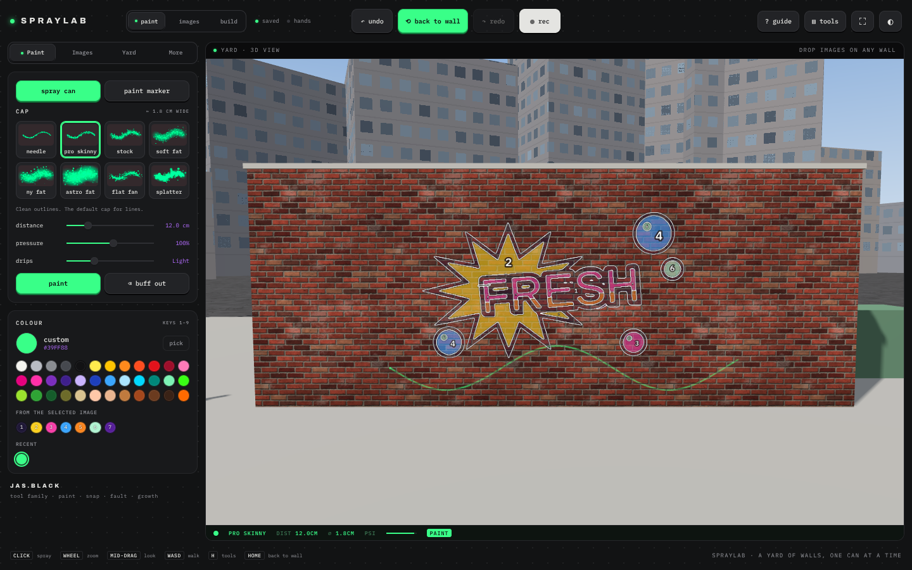

# SPRAYLAB by JAS.BLACK

Version 1.0.0

**A 3D graffiti wall studio in the browser: real spray caps, paint markers, image guides, auto paint and time-lapse export.** By [JAS.BLACK](https://jas.black).

**[Open it: spray.jas.black](https://spray.jas.black)** · **[The guide: every control, how it works](docs/GUIDE.md)**



Spraylab puts a floating spray can in front of a yard of walls. Paint lands on the surface the way it does outside: soft mist from far away, sharp lines up close, and drips when you hold still too long. Drop any picture onto a wall and it becomes a see-through guide, split into numbered colour shapes and outlines to paint over. Auto paint can then paint it for you, the way a writer would, and record the result as a time-lapse. Everything runs on your GPU in the browser. Nothing is uploaded and no account is needed.

## Quick start

1. Open [spray.jas.black](https://spray.jas.black) in a current desktop Chrome, Edge, Firefox or Safari. WebGL 2 is required.
2. Hold the left mouse button to spray. Pick a cap and a colour in the panel on the left.
3. Drop an image onto any wall to get a guide. Use **images** mode to move, scale and rotate it.
4. Press **auto paint** (images tab) to watch it painted, with **record time-lapse** on to save a video.
5. Press **⟲ back to wall** whenever you get lost in the yard.

| Key | Action |
| --- | --- |
| Hold click / Space | Spray or draw |
| Wheel | Zoom |
| Middle-drag | Look around (Shift: pan) |
| W A S D | Walk |
| P · M · B | Paint · images · build mode |
| T | Spray can / paint marker |
| [ ] | Previous / next cap |
| X | Buff (erase) |
| Home | Back to the last wall you painted |
| Ctrl Z / Ctrl Shift Z | Undo / redo |
| H | Hide / show tools |

See the **[guide](docs/GUIDE.md)** for every control.

## Run locally

Clone the repo and serve the folder, for example:

```sh
python3 -m http.server 8000
```

Then open http://localhost:8000. `index.html` needs `vendor/three.min.js` beside it. Icons live in `public/` and are copied next to the page on deploy.

## Development

```
src/            editable source
  body.html     markup
  style.css     styles (JAS.BLACK console tokens, light + dark)
  a1_core.js    renderer, camera, scene, state
  a2_materials.js  procedural wall surfaces (albedo, height, gloss, AO)
  a3_walls.js   walls, yard layout, parallax wall shader
  a4_paint.js   caps, markers, paint splats, drips, mist
  a5_guide.js   image guides: colour shapes, outlines, numbers
  a6_auto.js    auto paint planner and time-lapse
  a7_input.js   mouse, keyboard, touch
  a8_ui.js      panel and top bar
  a9_extras.js  hand tracking, colour picking, live room
  a11_store.js  autosave (IndexedDB) and project files
  a10_boot.js   start-up and render loop
  model.js      the JAS spray can mesh and label texture
build.py        inlines src/ into index.html
index.html      built page (committed)
vendor/         three.js r128
public/         icons, web manifest and link-preview card (deployed beside the page)
design/         sources for the icons
```

Edit files in `src/`, then rebuild and commit `index.html` with your changes:

```sh
python3 build.py
```

CI fails if `index.html` is out of date with `src/` (`python3 build.py --check` runs the same test locally).

## Deployment

`.github/workflows/pages.yml` checks the scripts, checks the build and publishes to GitHub Pages on every push to `main`.

One-time setup:

1. Repo **Settings → Pages → Source: GitHub Actions**.
2. Same page, **Custom domain:** `spray.jas.black`, then tick **Enforce HTTPS** once the certificate is issued.
3. At your DNS provider, add a `CNAME` record: `spray` → `jasblack.github.io`.

## Status

Works in current desktop browsers. Phones and tablets can paint with touch, but the panel is cramped on small screens. Hand tracking needs a webcam and downloads the MediaPipe hand model from cdn.jsdelivr.net and storage.googleapis.com when you start the camera. Live multi-user painting only works when Spraylab is opened as a shared Claude artifact, so it is hidden on the website.

## Licence and credits

MIT, see [LICENSE](LICENSE). Built by [JAS.BLACK](https://jas.black).

- [three.js](https://threejs.org) r128, MIT.
- [MediaPipe Tasks Vision](https://github.com/google-ai-edge/mediapipe) hand landmarker, Apache 2.0, loaded on demand.
- [Archivo](https://fonts.google.com/specimen/Archivo) and [IBM Plex Mono](https://fonts.google.com/specimen/IBM+Plex+Mono), SIL Open Font License, via Google Fonts.
- Spray can model and label: JAS.BLACK.

Part of the JAS.BLACK tool family with Code Painter ([paint.jas.black](https://paint.jas.black)), SnipSnap ([snap.jas.black](https://snap.jas.black)), Fault ([fault.jas.black](https://fault.jas.black)) and Growth ([growth.jas.black](https://growth.jas.black)).
